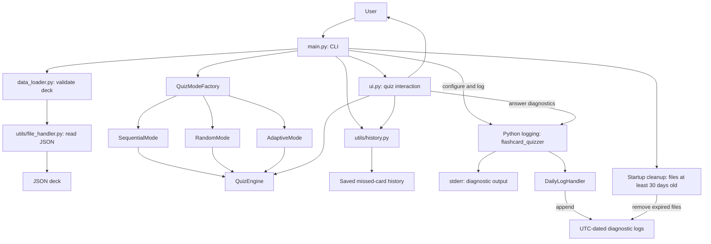

# The Flashcard Quizzer

Quiz yourself from a JSON deck in sequential, random, or adaptive order.
From this directory, for example:

```bash
python main.py --file data/glossary.json --mode sequential
python main.py -f data/python_basics.json -m adaptive --stats
```

Decks may be a JSON array or an object containing a `cards` array. The array
must contain at least one card, and each card must have nonempty string
`front` and `back` fields. Invalid decks produce a helpful error.
If access is denied, the current user needs read permission on the deck file
and search/traverse permission on its parent directories.

## Playing

`-f` / `--file` selects the deck. `-m` / `--mode` chooses `sequential`
(the default), `random`, or `adaptive`. Each card is asked once per session.
Answers are compared case-insensitively after trimming surrounding whitespace.
Empty answers are rejected and prompted again without affecting the score.
Type `exit`, press Ctrl+C, or send EOF to end early. The summary shows
completed questions, accuracy, and missed terms, including on an early exit.
Because `exit` is reserved for quitting, it cannot be submitted as an answer.
Feedback is green or red on supported terminals; set `NO_COLOR` to disable
colors.

Diagnostic logs go to stderr and UTC-dated files under
`~/.flashcard_quizzer/logs/`. They include full deck and history paths, card
fronts and backs, and submitted answers. Use `--verbose` to include debug
details and tracebacks for errors. Treat logs as sensitive and restrict access
to the log directory.

At startup, the app deletes its dated log files once every entry in the file
is at least 30 days old. Daily grouping can retain an entry for nearly one
additional day, and logs remain longer if the app is not started. Retention
does not cover stderr captured elsewhere or the separate quiz history. If
cleanup fails, the app reports the error and does not start the quiz. If a
log write fails during a quiz, it warns once and continues logging to stderr.
Do not run simultaneous quizzes: their log writes are not coordinated.

Each answer updates local history under `~/.flashcard_quizzer/`. A wrong answer
increases that card's unresolved miss count; a correct answer clears it.
Adaptive mode asks cards with the most unresolved misses first, preserving deck
order for ties. `--stats` shows the current deck's saved misses before the quiz;
the session summary is always shown. History is associated with the resolved
deck path and card contents, so moving a deck or changing a card starts new
history for the affected deck or card. Identical cards in the same deck share
history. Do not run simultaneous quizzes on the same deck: concurrent history
updates are not coordinated.

## Architecture

Editable versions: [draw.io](docs/architecture.drawio) and
[D2](docs/architecture.d2).



## What's in the starter

```
starter/
├── main.py                 # CLI entry point
├── data_loader.py          # Flashcard validation
├── quiz_engine.py          # Quiz strategies, factory, and results
├── ui.py                   # Terminal interaction
├── gui.py                  # Placeholder for a future graphical interface
├── data/                   # Sample flashcard decks
│   ├── glossary.json       # Array format: [{"front": ..., "back": ...}]
│   └── python_basics.json  # Object format: {"cards": [...]}
├── utils/                  # File and history helpers
├── tests/                  # pytest suite
├── docs/
│   ├── ai_edit_log.md      # AI interaction log (required, 5+ entries)
│   ├── report_template.md  # Final report template (required, 1,000-1,500 words)
│   └── design_patterns.md  # Pattern reference
├── ai_guidance/            # Prompting and code review guides
├── .claude/                # Claude Code configuration and slash commands
└── requirements.txt        # Quality tools: pytest, black, flake8, mypy, ...
```

The two sample decks use the two JSON formats your loader must support. You can add your own decks to `data/`.

## Getting started

1. Install Python 3.9 or newer and open a terminal at the repository root.
2. Create a virtual environment if `.venv` does not already exist. On Windows
   PowerShell:

   ```powershell
   py -3 -m venv .venv
   ```

   On macOS or Linux:

   ```bash
   python3 -m venv .venv
   ```

3. Enter the starter directory and install its development dependencies. On
   Windows PowerShell, use the virtual environment's interpreter directly:

   ```powershell
   cd project\starter
   ..\..\.venv\Scripts\python.exe -m pip install -r requirements.txt
   ```

   On macOS or Linux:

   ```bash
   cd project/starter
   ../../.venv/bin/python -m pip install -r requirements.txt
   ```

4. Verify the setup and start a quiz. From `project/starter`, on Windows:

   ```powershell
   ..\..\.venv\Scripts\python.exe -m pytest -q
   ..\..\.venv\Scripts\python.exe main.py -f data\glossary.json
   ```

   On macOS or Linux:

   ```bash
   ../../.venv/bin/python -m pytest -q
   ../../.venv/bin/python main.py -f data/glossary.json
   ```

These commands do not require activating the virtual environment. To use the
shorter `python` commands below, first activate `.venv` in your shell.

## Development checks

```bash
python -m pytest --cov=. --cov-report=html   # target: >80% coverage
python -m black --check .
python -m flake8 .
python -m mypy .
```

## What to submit

Check the Instructions page and the rubric for the full list. In short:

- Your complete source code, the `tests/` suite, and the `data/` decks
- `docs/ai_edit_log.md` with at least 5 detailed AI interactions
- The final report, written from `docs/report_template.md` (1,000-1,500 words)
- This README, rewritten to describe **your** application: features, setup, and usage examples

## License

[License](../../LICENSE.txt)
